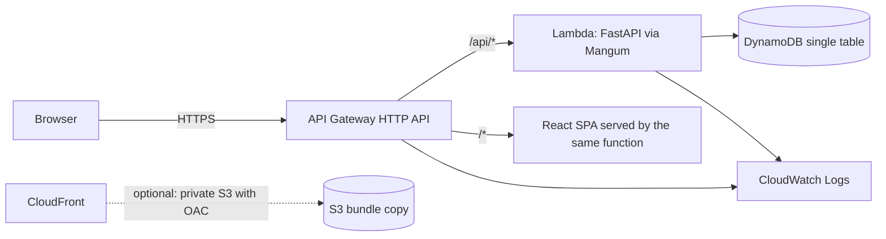
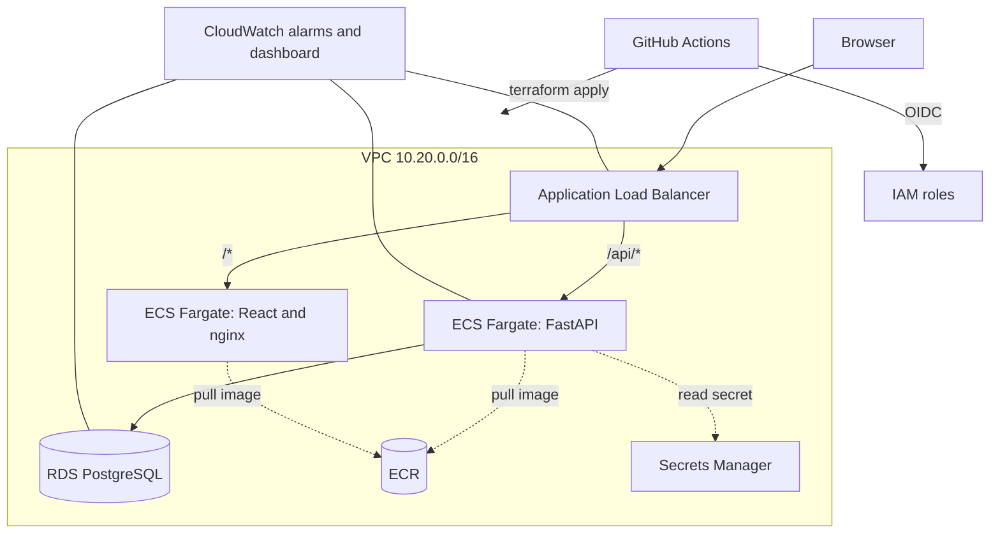

# CloudForge

CloudForge is a working reference for running a small application on AWS the way a platform
team would: infrastructure described in code, pipelines that authenticate without storing any
keys, releases that can undo themselves, and a monthly bill that stays at zero.

[](https://github.com/LOKESHPJ/enterprise-cloud-platform/actions/workflows/deploy-serverless.yml)
[](https://github.com/LOKESHPJ/enterprise-cloud-platform/actions/workflows/security-scan.yml)
[](LICENSE)

The application is a small storefront: browse a catalogue, add items to a cart, place an
order, look at order history. It exists so the platform has something real to deploy. The
Terraform, pipelines, scanning gates, release mechanics and cost controls around it are the
part worth copying into other projects.

Nothing runs on a developer machine. No localhost, no local database, no Docker Desktop.
Builds, tests, scans and deploys all happen on GitHub runners.

## Contents

- [What this is](#what-this-is)
- [See it running](#see-it-running)
- [How it works](#how-it-works)
- [Architecture](#architecture)
- [Repository map](#repository-map)
- [Quick start](#quick-start)
- [Operating the platform](#operating-the-platform)
- [Security posture](#security-posture)
- [What it costs](#what-it-costs)
- [Known limitations](#known-limitations)
- [Documentation](#documentation)
- [Contributing](#contributing)
- [License](#license)

## What this is

There are two deployment tracks sharing one application codebase.

| Track | What it provisions | Monthly | How it deploys |
|---|---|---|---|
| `infrastructure/serverless/` | Lambda, API Gateway, DynamoDB, S3, CloudWatch, Budget | **$0.00** (free tier) | Automatically on push to `main` |
| `infrastructure/terraform/` | VPC, ALB, ECS Fargate, RDS PostgreSQL, ECR, Secrets Manager, CloudWatch | about $43 to $52 | Manually, behind a spend gate, in two phases |

The serverless track is what is live today. The enterprise track is the full production
architecture. It is written and validated but never applied, because it bills hourly and the
account it targets cannot run it for free yet. An architecture nobody can afford to switch on
makes a poor demo.

### What runs where

| Concern | Runs on |
|---|---|
| Editing | any editor |
| Build, type check, image build, scans | GitHub Actions runners |
| `terraform plan` and `apply` | GitHub Actions runners |
| Application | AWS Lambda (live), ECS Fargate (enterprise) |
| Database | DynamoDB (live), RDS PostgreSQL (enterprise) |
| Terraform state | S3 bucket plus a DynamoDB lock table |
| AWS credentials | GitHub OIDC to STS, valid for one hour, nothing stored |
| localhost, local database, local Docker | not used |

Once code is pushed, the developer machine can be switched off. The pipeline will still
build, deploy and verify the platform.

## See it running

- App: `https://<api-id>.execute-api.us-east-1.amazonaws.com`
- API docs: `/api/docs`, generated from the running code
- Health: `/api/health`, which reports the storage backend and performs a real round trip

Every deploy prints the current URL in the run summary, and `terraform output` returns it as
`api_base_url` and `site_url`.

## How it works

Git holds the intent. GitHub Actions reconciles AWS until it matches. Then the pipeline proves
the result actually works, and puts the previous release back if it does not.

### The pipeline, stage by stage

A push to `main` that touches `application/**` or `infrastructure/serverless/**` starts
[`deploy-serverless.yml`](.github/workflows/deploy-serverless.yml).

| # | Job | What it does | Fails when |
|---|---|---|---|
| 1 | validate | Runs `python -m compileall`, `npm install` and `tsc --noEmit`. No AWS access | Python or TypeScript does not compile |
| 2 | provision | Assumes the deploy role through OIDC, builds the SPA and the Lambda zip, runs `terraform init` against S3 state with a DynamoDB lock, then `fmt -check`, `validate`, `plan`, `apply`, and exports the outputs | Terraform cannot reconcile, or a permission is missing |
| 3 | release | Publishes an immutable Lambda version and moves the `live` alias onto it | The alias cannot be updated |
| 4 | ship | Rebuilds the SPA, uploads it to S3, seeds the catalogue if it is empty, then runs API and site smoke tests. On failure it moves the alias back | Any smoke test fails |

The rest of the workflows are narrower and do one job each.

| Workflow | Trigger | Purpose |
|---|---|---|
| [`security-scan.yml`](.github/workflows/security-scan.yml) | push, pull request | Trivy for dependency CVEs and leaked secrets, Checkov for Terraform policy, Gitleaks over history |
| [`terraform-plan.yml`](.github/workflows/terraform-plan.yml) | manual | Read-only plan, no apply |
| [`build-push.yml`](.github/workflows/build-push.yml) | push, manual | Builds both images, scans them, then pushes to ECR. Exits quietly when ECR does not exist yet |
| [`deploy-enterprise.yml`](.github/workflows/deploy-enterprise.yml) | manual, typed confirmation | The VPC, ALB, ECS and RDS stack, in two phases |
| [`destroy-serverless.yml`](.github/workflows/destroy-serverless.yml), [`destroy-enterprise.yml`](.github/workflows/destroy-enterprise.yml) | manual, typed confirmation | Teardown |

### A request at runtime

```
Browser -> API Gateway (HTTP API) -> Lambda alias "live"
                                      |- /api/*  -> FastAPI routers -> DynamoDB
                                      '- /*      -> static/index.html and /assets
```

API Gateway sends `ANY /api/{proxy+}` to the function and lets `$default` catch everything
else, so the UI and the API share one HTTPS origin. That removes CORS from the picture
entirely.

Mangum adapts the API Gateway event into an ASGI call, so the Lambda is plain FastAPI with no
Lambda-specific code in the routes. API Gateway always invokes the `live` alias, never
`$LATEST`, which is what makes an alias switch a complete release.

Money is stored as integer cents everywhere. Order totals are recalculated from the catalogue
at checkout, so a tampered request cannot change the amount charged. Products sit at
`pk=PRODUCT#<id>` and orders at `pk=ORDER#<id>`, and the list endpoints query the `gsi1` index
rather than scanning the table.

### Authentication without secrets

```
GitHub mints a JWT per run:  sub = repo:<owner>@<id>/<repo>@<id>:ref:refs/heads/main
Actions calls sts:AssumeRoleWithWebIdentity with that token
AWS checks aud and sub against the role trust policy (main branch, or environment:*)
STS returns credentials valid for one hour
```

There is nothing to leak and nothing to rotate. A pull request from a fork carries a
different `sub` claim and is refused. The roles are scoped by service family, can only touch
`cloudforge-*` IAM roles, and are explicitly denied IAM user, access key, Organizations and
Account actions.

## Architecture

### Live track



Setting `enable_cloudfront=true` moves static hosting behind CloudFront with Origin Access
Control, which is the better production shape. It stays off by default because AWS will not
create CloudFront distributions on accounts that have not finished verification. API Gateway
keeps the platform deployable in the meantime.

### Enterprise track, cost gated



Trust boundaries, failure modes and the data model are in
[`docs/ARCHITECTURE.md`](docs/ARCHITECTURE.md).

## Repository map

```
application/
  backend/            FastAPI, storage abstraction (DynamoDB or PostgreSQL), Mangum adapter, Dockerfile
  frontend/           React, TypeScript, Vite, nginx Dockerfile
infrastructure/
  serverless/         live track: Lambda, HTTP API, DynamoDB, S3, CloudFront, alarms, budget
  terraform/          enterprise track: VPC, ALB, ECS, RDS, ECR, secrets, monitoring
    modules/          vpc, ecr, iam, secrets, rds, alb, ecs, monitoring
docker/               nginx config baked into the frontend image
.github/workflows/    the pipelines listed above
.checkov.yaml         documented IaC policy exceptions
scripts/bootstrap.sh  one-time setup: OIDC provider, deploy roles, state backend
docs/                 architecture, costs, runbook
```

Where to start, depending on what you want to understand:

| Goal | Read |
|---|---|
| How a deploy works | [`.github/workflows/deploy-serverless.yml`](.github/workflows/deploy-serverless.yml) |
| How the application works | [`application/backend/app/main.py`](application/backend/app/main.py) |
| How data is modelled | [`application/backend/app/storage/dynamo.py`](application/backend/app/storage/dynamo.py) |
| What is actually deployed | [`infrastructure/serverless/`](infrastructure/serverless) |
| The production architecture | [`infrastructure/terraform/`](infrastructure/terraform) |
| What the AWS account needs | [`scripts/bootstrap.sh`](scripts/bootstrap.sh) |
| How to fix something at 2am | [`docs/RUNBOOK.md`](docs/RUNBOOK.md) |
| Why the bill looks like that | [`docs/COSTS.md`](docs/COSTS.md) |

## Quick start

You need an AWS account, permission to create IAM roles, and admin rights on a GitHub
repository. The region defaults to `us-east-1`.

```bash
# 1. clone
git clone https://github.com/LOKESHPJ/enterprise-cloud-platform.git
cd enterprise-cloud-platform

# 2. one-time AWS setup: OIDC provider, two scoped roles, S3 state and a DynamoDB lock
#    run this in CloudShell or any shell with administrative credentials
REPO=<owner>/<repo> bash scripts/bootstrap.sh

# 3. point the workflows at what the bootstrap created
gh variable set TF_STATE_BUCKET         --body "cloudforge-tfstate-<account-id>"
gh variable set AWS_SERVERLESS_ROLE_ARN --body "arn:aws:iam::<account-id>:role/cloudforge-gha-serverless"
gh variable set AWS_TERRAFORM_ROLE_ARN  --body "arn:aws:iam::<account-id>:role/cloudforge-gha-terraform"
gh variable set COST_ALERT_EMAIL        --body "you@example.com"

# 4. deploy
gh workflow run deploy-serverless.yml
gh run watch
```

The workflows already carry those role ARNs and the bucket name as defaults, so step 3 is for
clarity rather than correctness. The bootstrap creates no access keys. If an IAM user exists
afterwards, it was a temporary bootstrap credential and should be deleted.

To rename things, change `project` and `environment`, which together produce the
`cloudforge-dev-*` resource names. `monthly_budget_usd` sets the budget, `enable_cloudfront`
toggles the CDN, and `alert_email` turns on budget notifications.

## Operating the platform

### Deploy

Push to `main`, or run Actions then Deploy serverless then Run workflow. The summary of each
run carries the URL, the API endpoint and the commit.

### Roll back

The pipeline usually handles it. If a smoke test fails after the alias moves, the
`Roll back alias after failed verification` step points the alias at the previous version. To
do it yourself:

```bash
FUNCTION=cloudforge-dev-api
CURRENT=$(aws lambda get-alias --function-name $FUNCTION --name live --query FunctionVersion --output text)
PREVIOUS=$(aws lambda list-versions-by-function --function-name $FUNCTION \
  --query 'Versions[].Version' --output text | tr '\t' '\n' | sort -n | awk -v c=$CURRENT '$1<c' | tail -1)
aws lambda update-alias --function-name $FUNCTION --name live --function-version $PREVIOUS
```

That takes seconds and needs no rebuild or Terraform run.

### Tear down

Run Actions then Destroy serverless, and type `destroy`. The state bucket is kept on purpose
so the stack can be rebuilt later with its history intact.

Incident triage, log commands, password rotation and the enterprise deploy procedure are all
in [`docs/RUNBOOK.md`](docs/RUNBOOK.md).

## Security posture

| Control | How it is done |
|---|---|
| No static credentials | OIDC only, with trust pinned to `main` and `environment:*` using immutable subject claims |
| Least privilege | Per-service deploy policies, IAM limited to `cloudforge-*` roles, explicit deny on users, keys, Organizations and Account |
| Artifact vetting | Trivy for CVEs and secrets, Checkov with 192 checks passing, Gitleaks over full history, and an image scan before any push |
| Network | Buckets private with public access blocked, RDS unreachable from the internet, default VPC security group stripped of every rule |
| Data in transit | `rds.force_ssl=1`, TLS 1.2 or newer on the CDN when enabled, HSTS and the usual browser headers |
| Secrets | Database password generated and stored in Secrets Manager, task definitions reference keys rather than values |
| Privacy | Customer addresses are masked in every response. The catalogue is read-only over HTTP, so no visitor can deface or empty it |
| Abuse limits | API Gateway throttles at 100 requests per second with a burst of 200, and stored orders stop at 500 |

Gaps that were accepted on purpose are listed with reasons in [`.checkov.yaml`](.checkov.yaml)
and in [Known limitations](#known-limitations).

## What it costs

| Track | Idle monthly | Notes |
|---|---|---|
| Serverless, live | **$0.00** | Fits inside the Lambda, API Gateway, DynamoDB, S3 and CloudWatch free allowances |
| Enterprise, cost mode | about $43 to $52 | ALB around $18, Fargate around $15, RDS around $13, roughly $1 for the rest |
| Enterprise, production mode | about $85 and up | Adds NAT gateways, Multi-AZ RDS and more tasks |

Four things keep the bill honest: an AWS Budget with alerts at 50, 80 and 100 percent, cost
allocation tags on every resource, seven day log retention, and a `confirm_spend` gate that
makes a bare `terraform apply` on the enterprise track fail rather than start the meter.

Prices and the levers that change them are in [`docs/COSTS.md`](docs/COSTS.md).

## Known limitations

These are scope decisions rather than surprises waiting to happen.

- There is no authentication on the API. Anyone with the URL can create an order. The service
  masks addresses in every response, refuses all catalogue writes and stops accepting orders
  after 500 rows, but a determined visitor can still add junk orders until that cap. It is a
  catalogue demo, not a payment system, and Cognito is the obvious next step.
- There is no WAF and no rate limiting beyond the API Gateway throttle. WAF costs around
  $5 per month per ACL.
- Everything runs in one region. There is no failover and no cross-region backup.
- Stock is validated but not reserved, so simultaneous orders can oversell.
- The enterprise track has never been applied. It is validated and gated, not running.
- CloudFront and CodeDeploy stay unavailable until AWS verifies the account. The platform
  falls back to API Gateway static serving and alias based releases, both described in
  `docs/ARCHITECTURE.md`.

## Documentation

| Document | Contents |
|---|---|
| [`docs/ARCHITECTURE.md`](docs/ARCHITECTURE.md) | Components, request paths, trust boundaries, release model, failure modes |
| [`docs/COSTS.md`](docs/COSTS.md) | Line item pricing, free tier limits, cost levers, budget setup |
| [`docs/RUNBOOK.md`](docs/RUNBOOK.md) | Bootstrap, deploy, rollback, incident triage, credential rotation, teardown |
| [`docker/README.md`](docker/README.md) | How the two images are built and tagged |

## Contributing

Issues and pull requests are welcome.

1. Branch from `main`.
2. Run `terraform fmt -recursive .` and `terraform validate` before pushing, or let CI tell
   you what to fix.
3. Keep `.checkov.yaml` exceptions justified. Every entry needs a reason, not a `# skip`.
4. Pull requests run the security scans, and a HIGH or CRITICAL finding blocks the merge.

Commit messages follow Conventional Commits, so `git log --oneline` reads like a changelog.

## License

MIT, see [LICENSE](LICENSE). Copyright 2026 LOKESHPJ. Free to use, modify and distribute with
attribution.
