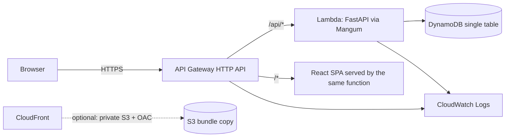
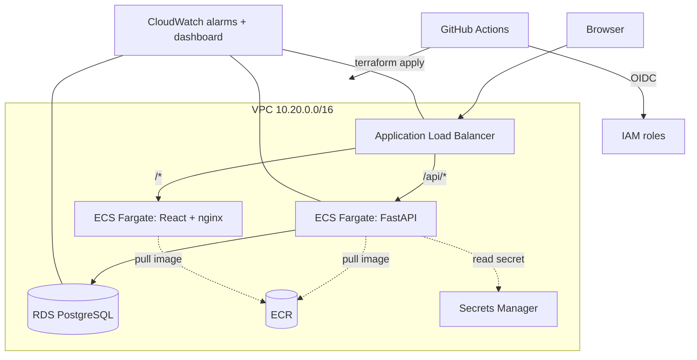

# CloudForge

**Enterprise Cloud Platform Engineering** — infrastructure, CI/CD, security gates, releases
and cost controls for AWS, delivered entirely from GitHub.

[](https://github.com/LOKESHPJ/enterprise-cloud-platform/actions/workflows/deploy-serverless.yml)
[](https://github.com/LOKESHPJ/enterprise-cloud-platform/actions/workflows/security-scan.yml)
[](LICENSE)

A small e-commerce service (catalogue → cart → order) is the reference workload. The
platform around it — Terraform, OIDC-authenticated pipelines, scanning gates, immutable
releases with automatic rollback, monitoring, budget guardrails — is what is meant to be
reused for other applications.

Nothing runs on a developer machine: no `localhost`, no local database, no Docker Desktop.
Builds, tests, scans and deployments all execute on GitHub runners.

---

## Contents

- [What this is](#what-this-is)
- [See it running](#see-it-running)
- [How it works](#how-it-works)
- [Architecture](#architecture)
- [Repository map](#repository-map)
- [Quick start](#quick-start)
- [Operating the platform](#operating-the-platform)
- [Security posture](#security-posture)
- [What it costs](#what-it-costs)
- [Known limitations](#known-limitations)
- [Documentation](#documentation)
- [Contributing](#contributing)
- [License](#license)

---

## What this is

Two deployment tracks share one application codebase:

| Track | Provisions | Monthly | How it is deployed |
|---|---|---|---|
| **`infrastructure/serverless/`** | Lambda · API Gateway · DynamoDB · S3 · CloudWatch · Budget | **$0.00** (free tier) | Automatic on push to `main` |
| **`infrastructure/terraform/`** | VPC · ALB · ECS Fargate · RDS PostgreSQL · ECR · Secrets Manager · CloudWatch | ~$43–52 | Manual, cost-gated, two-phase |

The serverless track is what is live. The enterprise track is the full production
architecture — written, validated and deliberately locked behind an explicit spend
confirmation, because an architecture you cannot afford to run is not a demo.

### What runs where

| Concern | Runs on |
|---|---|
| Authoring | any editor |
| Build, type-check, image build, scans | GitHub Actions runners |
| `terraform plan` / `apply` | GitHub Actions runners |
| Application | AWS Lambda (live) · ECS Fargate (enterprise) |
| Database | DynamoDB (live) · RDS PostgreSQL (enterprise) |
| Terraform state | S3 + DynamoDB lock table |
| AWS credentials | GitHub OIDC → STS, one hour, zero keys |
| `localhost` / local DB / local Docker | not used |

Switch the developer machine off after `git push` and the pipeline still builds, ships and
verifies the platform.

---

## See it running

- **App:** `https://<api-id>.execute-api.us-east-1.amazonaws.com`
- **API docs:** `/api/docs` (Swagger, generated from the code)
- **Health:** `/api/health` — reports the storage backend and a real round trip

The exact URL is printed by the **provision** job of every deploy
(`api_base_url` / `site_url` Terraform outputs) and recorded in the run summary.

---

## How it works

### Lifecycle in one line

> Git holds the intent. GitHub Actions reconciles AWS to match it. The pipeline then proves
> the result works, and reverts the release if it does not.

### The pipeline, stage by stage

A push to `main` that touches `application/**` or `infrastructure/serverless/**` runs
[`deploy-serverless.yml`](.github/workflows/deploy-serverless.yml):

| # | Job | What it actually does | Fails the run when |
|---|---|---|---|
| 1 | **validate** | `python -m compileall`, `npm install`, `tsc --noEmit`. No AWS access at all | Python or TypeScript does not compile |
| 2 | **provision** | Assumes the deploy role via OIDC → builds the SPA and Lambda zip → `terraform init` (S3 state + DynamoDB lock) → `fmt -check` → `validate` → `plan` → `apply` → exports outputs | Terraform cannot reconcile, or any permission is missing |
| 3 | **release** | Publishes an immutable Lambda version, then moves the `live` alias to it | The alias cannot be updated |
| 4 | **ship** | Rebuilds the SPA, uploads to S3, seeds the catalogue if empty, then runs API and site smoke tests. On failure, moves the alias back | Any smoke test fails |

Everything else is a separate, narrower workflow:

| Workflow | Trigger | Purpose |
|---|---|---|
| [`security-scan.yml`](.github/workflows/security-scan.yml) | push, PR | Trivy (dependency CVEs + secrets), Checkov (Terraform policy), Gitleaks (history) |
| [`terraform-plan.yml`](.github/workflows/terraform-plan.yml) | manual | Read-only plan, no apply |
| [`build-push.yml`](.github/workflows/build-push.yml) | push, manual | Builds container images, **scans them**, then pushes to ECR. Skips cleanly when ECR is not provisioned |
| [`deploy-enterprise.yml`](.github/workflows/deploy-enterprise.yml) | manual + typed confirmation | VPC/ALB/ECS/RDS stack, two-phase |
| [`destroy-serverless.yml`](.github/workflows/destroy-serverless.yml) · [`destroy-enterprise.yml`](.github/workflows/destroy-enterprise.yml) | manual + typed confirmation | Teardown |

### A request at runtime

```
Browser ──HTTPS──▶ API Gateway (HTTP API) ──▶ Lambda alias "live"
                                               ├─ /api/*  → FastAPI routers → DynamoDB
                                               └─ /*      → static/index.html + /assets
```

- API Gateway matches `ANY /api/{proxy+}` for the API and `$default` for the SPA; both target
  the same function, so the UI and API share one HTTPS origin — **no CORS**.
- **Mangum** adapts the API Gateway event to ASGI, so the function is ordinary FastAPI.
- The alias is the release unit: API Gateway invokes `live`, never `$LATEST`.
- Money is integer cents end to end; order totals are recomputed from the catalogue at
  checkout, never trusted from the browser.
- Products live at `pk=PRODUCT#<id>`, orders at `pk=ORDER#<id>`; list endpoints query the
  `gsi1` index rather than scanning.

### Authentication without secrets

```
GitHub mints a per-run JWT   sub = repo:<owner>@<id>/<repo>@<id>:ref:refs/heads/main
Actions calls sts:AssumeRoleWithWebIdentity
AWS checks aud + sub against the role's trust policy (main branch, or environment:*)
STS returns credentials valid for one hour
```

Nothing to leak, nothing to rotate. A fork's pull request carries a different `sub` and is
refused. The roles are scoped per service family, limited to `cloudforge-*` IAM roles, and
explicitly denied IAM user, access-key, Organizations and Account actions.

---

## Architecture

### Live track



`enable_cloudfront=true` moves static hosting behind CloudFront with Origin Access Control
(better production shape). It is off by default because AWS blocks CloudFront creation on
accounts that have not finished verification; API Gateway keeps the platform deployable on
day one.

### Enterprise track (cost-gated)



Trust boundaries, failure modes and the data model:
[`docs/ARCHITECTURE.md`](docs/ARCHITECTURE.md).

---

## Repository map

```
application/
  backend/            FastAPI · storage abstraction (DynamoDB / PostgreSQL) · Mangum adapter · Dockerfile
  frontend/           React + TypeScript + Vite · nginx Dockerfile
infrastructure/
  serverless/         live track: Lambda, HTTP API, DynamoDB, S3, CloudFront, alarms, budget
  terraform/          enterprise track: VPC, ALB, ECS, RDS, ECR, secrets, monitoring
    modules/          vpc · ecr · iam · secrets · rds · alb · ecs · monitoring
docker/               nginx config baked into the frontend image
.github/workflows/    the pipelines listed above
.checkov.yaml         documented IaC policy exceptions
scripts/bootstrap.sh  one-time: OIDC provider, deploy roles, state backend
docs/                 architecture · costs · runbook
```

**Start here depending on what you want to understand:**

| You want to… | Read |
|---|---|
| See how a deploy works | [`.github/workflows/deploy-serverless.yml`](.github/workflows/deploy-serverless.yml) |
| Understand the app | [`application/backend/app/main.py`](application/backend/app/main.py) |
| Understand the data model | [`application/backend/app/storage/dynamo.py`](application/backend/app/storage/dynamo.py) |
| Review the live infrastructure | [`infrastructure/serverless/`](infrastructure/serverless) |
| Review the production architecture | [`infrastructure/terraform/`](infrastructure/terraform) |
| Know what the account needs | [`scripts/bootstrap.sh`](scripts/bootstrap.sh) |
| Fix something at 2am | [`docs/RUNBOOK.md`](docs/RUNBOOK.md) |
| Understand the bill | [`docs/COSTS.md`](docs/COSTS.md) |

---

## Quick start

**Prerequisites:** an AWS account, permission to create IAM roles, and admin on a GitHub
repository. Region defaults to `us-east-1`.

```bash
# 1. clone
git clone https://github.com/LOKESHPJ/enterprise-cloud-platform.git
cd enterprise-cloud-platform

# 2. one-time AWS bootstrap: OIDC provider, two scoped roles, S3 state + DynamoDB lock
#    (run in CloudShell or any shell with administrative credentials)
REPO=<owner>/<repo> bash scripts/bootstrap.sh

# 3. point the workflows at what the bootstrap created
gh variable set TF_STATE_BUCKET        --body "cloudforge-tfstate-<account-id>"
gh variable set AWS_SERVERLESS_ROLE_ARN --body "arn:aws:iam::<account-id>:role/cloudforge-gha-serverless"
gh variable set AWS_TERRAFORM_ROLE_ARN  --body "arn:aws:iam::<account-id>:role/cloudforge-gha-terraform"
gh variable set COST_ALERT_EMAIL        --body "you@example.com"

# 4. deploy
gh workflow run deploy-serverless.yml
gh run watch
```

The workflows carry the same role ARNs and bucket name as defaults, so step 3 is for
clarity rather than correctness. The bootstrap creates **no access keys** — if an IAM user
exists, it is a temporary bootstrap credential and should be deleted immediately afterwards.

**Customise:** `project` and `environment` rename every resource
(`cloudforge-dev-*`), `monthly_budget_usd` sets the budget, `enable_cloudfront` toggles the
CDN, `alert_email` enables budget notifications.

---

## Operating the platform

### Deploy

Push to `main`. To deploy without a code change: **Actions → Deploy serverless → Run
workflow**. The run summary contains the URL, API endpoint and commit.

### Roll back

The pipeline does it for you — if a smoke test fails after the alias moves, the
`Roll back alias after failed verification` step moves it back. By hand:

```bash
FUNCTION=cloudforge-dev-api
CURRENT=$(aws lambda get-alias --function-name $FUNCTION --name live --query FunctionVersion --output text)
PREVIOUS=$(aws lambda list-versions-by-function --function-name $FUNCTION \
  --query 'Versions[].Version' --output text | tr '\t' '\n' | sort -n | awk -v c=$CURRENT '$1<c' | tail -1)
aws lambda update-alias --function-name $FUNCTION --name live --function-version $PREVIOUS
```

Seconds, no rebuild, no Terraform.

### Tear down

Actions → **Destroy serverless** → type `destroy`. The state bucket is intentionally retained
so the stack can be rebuilt with history intact.

Full procedures — incident triage, log commands, password rotation, enterprise deploy:
[`docs/RUNBOOK.md`](docs/RUNBOOK.md).

---

## Security posture

| Control | Implementation |
|---|---|
| No static credentials | OIDC only; trust pinned to `main` and `environment:*` using immutable subject claims |
| Least privilege | Service-scoped deploy policies; IAM limited to `cloudforge-*` roles; explicit deny on users, keys, Organizations |
| Artifact vetting | Trivy (CVEs + secrets), Checkov (**192 checks, 0 failing**), Gitleaks (full history), image scan **before** push |
| Network | Private buckets with public access blocked; RDS unreachable from the internet; default VPC security group stripped of all rules |
| Data in transit | `rds.force_ssl=1`; TLS 1.2+ on the CDN when enabled; HSTS, `X-Content-Type-Options`, `X-Frame-Options` |
| Secrets | Generated DB password stored in Secrets Manager; task definition references keys, never values |
| Abuse limits | API Gateway 100 req/s, burst 200 |

Accepted gaps are listed with reasons in [`.checkov.yaml`](.checkov.yaml) and
[Known limitations](#known-limitations) — not hidden.

---

## What it costs

| Track | Idle monthly | Notes |
|---|---|---|
| Serverless (live) | **$0.00** | Inside Lambda, API Gateway, DynamoDB, S3 and CloudWatch free allowances |
| Enterprise (cost mode) | ~$43–52 | ALB ~$18, Fargate ~$15, RDS ~$13, ~$1 misc |
| Enterprise (production mode) | ~$85+ | Adds NAT gateways, Multi-AZ RDS, more tasks |

Guardrails: an AWS Budget with 50/80/100% alerts, `Project`/`Environment`/`CostCenter`/`Owner`
tags on every resource, 7-day log retention, ECR lifecycle policy, and a hard
`confirm_spend` gate that makes a bare `terraform apply` on the enterprise track impossible.

Line items and levers: [`docs/COSTS.md`](docs/COSTS.md).

---

## Known limitations

These are deliberate scope decisions, stated so nobody discovers them in production:

- **No authentication on the API.** Anyone with the URL can create an order. It is a
  catalogue demo, not a payment system; adding Cognito is the obvious next step.
- **No WAF, no rate limiting beyond API Gateway throttling.** WAF is ~$5+/month per ACL.
- **Single region, no disaster recovery.** No multi-region failover or cross-region backups.
- **Stock is validated, not reserved.** Concurrent orders can oversell.
- **The enterprise track has never been applied.** It is validated and gated, not running.
- **CloudFront and CodeDeploy are unavailable until AWS verifies the account.** The
  platform degrades to API Gateway static serving and alias-based releases, both documented
  in `docs/ARCHITECTURE.md`.

---

## Documentation

| Document | Contents |
|---|---|
| [`docs/ARCHITECTURE.md`](docs/ARCHITECTURE.md) | Components, request paths, trust boundaries, release model, failure modes |
| [`docs/COSTS.md`](docs/COSTS.md) | Line-item pricing, free-tier limits, cost levers, budget setup |
| [`docs/RUNBOOK.md`](docs/RUNBOOK.md) | Bootstrap, deploy, rollback, incident triage, rotation, teardown |
| [`docker/README.md`](docker/README.md) | How the two images are built and tagged |

---

## Contributing

Issues and pull requests are welcome.

1. Branch from `main`.
2. `terraform fmt -recursive .` and `terraform validate` before pushing (or let CI tell you).
3. Keep `.checkov.yaml` exceptions justified — each entry needs a reason, not a `# skip`.
4. PRs run the security scans; a HIGH/CRITICAL finding blocks the merge by design.

Commit style follows Conventional Commits (`feat:`, `fix:`, `docs:`, `chore:`), which is why
`git log --oneline` reads as a changelog.

---

## License

[MIT](LICENSE) © 2026 LOKESHPJ — free to use, modify and distribute with attribution.
