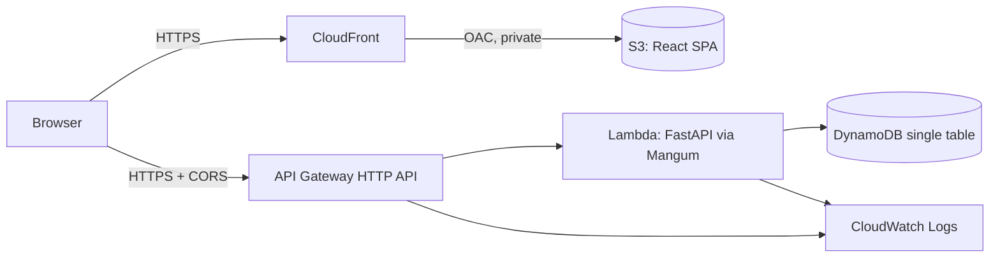
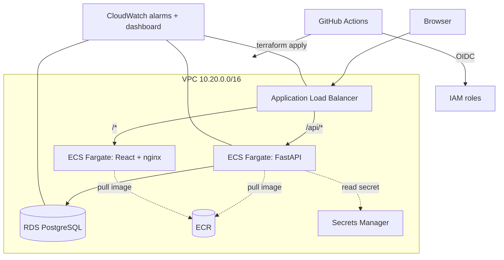

# Enterprise Cloud Platform

A production-shaped AWS platform delivered entirely through GitHub and AWS: no local
runtime, no local database, no Docker Desktop. Code is built on GitHub runners,
infrastructure is applied by Terraform from GitHub Actions using short-lived OIDC
credentials, and the application is reachable on a public HTTPS URL.

The repository ships **two deployment tracks that share one application codebase**:

| Track | What it provisions | Monthly cost | Status |
|---|---|---|---|
| **`infrastructure/serverless/`** | Lambda + API Gateway HTTP API + DynamoDB + S3 + CloudFront | **$0.00** (free tier) | Deployed automatically on push to `main` |
| **`infrastructure/terraform/`** | VPC, ALB, ECS Fargate, RDS PostgreSQL, ECR, Secrets Manager, CloudWatch | ~$43-52 | Manual, explicitly confirmed, cost-gated |

The enterprise track is the architecture from the specification. The serverless
track exists because the same requirements — push to deploy, IaC, OIDC, observability,
rollback — can be demonstrated for free, and a demo you cannot afford to run is not a
demo.

---

## Architecture

### Serverless track (live)



### Enterprise track (cost-gated)



Full detail, including trust boundaries and failure modes: [`docs/ARCHITECTURE.md`](docs/ARCHITECTURE.md).

---

## What runs where

| Concern | Where it runs |
|---|---|
| Authoring | any text editor |
| Build, test, Docker image build | GitHub Actions runners |
| `terraform plan` / `apply` | GitHub Actions runners |
| Application | AWS Lambda (free track) / ECS Fargate (enterprise track) |
| Database | AWS DynamoDB / AWS RDS |
| Terraform state | S3 + DynamoDB lock table |
| Credentials | GitHub OIDC → STS. No long-lived AWS keys exist anywhere |
| `localhost`, local DB, local Docker | not used |

After the initial `git push`, a developer machine can be switched off and the pipeline
still builds, deploys and verifies the platform.

---

## Repository layout

```
application/
  backend/                  FastAPI service, storage abstraction, Lambda adapter, Dockerfile
  frontend/                 React + Vite SPA, nginx Dockerfile
infrastructure/
  serverless/               free-tier track (Lambda, API GW, DynamoDB, S3, CloudFront)
  terraform/                enterprise track (VPC, ALB, ECS, RDS, ECR, secrets, monitoring)
    modules/{vpc,ecr,iam,secrets,rds,alb,ecs,monitoring}
docker/                     nginx config baked into the frontend image
.github/workflows/          validate, provision, ship, build+push, plan, destroy
scripts/bootstrap.sh        one-time OIDC provider, roles, state backend
docs/                       architecture, costs, runbook
```

---

## Application

**Backend** — FastAPI with a storage abstraction (`Repository`) and two
implementations: DynamoDB (single table, GSI) and PostgreSQL (SQLAlchemy 2.0). The same
module runs on Lambda via Mangum and on Fargate via uvicorn. Money is handled as integer
cents throughout; order totals are priced server side from the catalogue, never trusted
from the client.

Endpoints: `GET /api/health`, `GET|POST /api/products`, `GET|PATCH|DELETE /api/products/{id}`,
`GET|POST /api/orders`, `GET /api/orders/{id}`, OpenAPI at `/api/docs`.

**Frontend** — React 18 + TypeScript + Vite. Catalogue, cart, checkout, order history.
The API origin is injected at build time (`VITE_API_BASE_URL`) so the identical bundle
works against API Gateway or an ALB.

---

## Deploying

### Free track (automatic)

Push to `main`. `deploy-serverless.yml` runs:

1. `validate` — Python compile check, TypeScript type check
2. `provision` — builds the Lambda zip, `terraform fmt`/`validate`/`plan`/`apply` via OIDC
3. `ship` — builds the SPA against the deployed API URL, syncs to S3, invalidates CloudFront
4. smoke tests the API (health, catalogue, create order, list orders) and the site

Teardown: run **Destroy serverless** and type `destroy`.

### Enterprise track (deliberate)

1. Run **Deploy enterprise stack** with `confirm=DEPLOY-BILLABLE`,
   `enable_services=false` → creates VPC, ALB, RDS, ECR, secret, alarms
2. Run **Build and push images** → pushes `sha-<commit>` to both ECR repositories
3. Re-run **Deploy enterprise stack** with `enable_services=true` → creates the ECS
   services and verifies `/api/health` through the ALB
4. Teardown: **Destroy enterprise stack** with `confirm=DESTROY-BILLABLE`

Terraform refuses to plan the enterprise track unless `confirm_spend=true`, so a bare
`terraform apply` cannot start the meter.

---

## Engineering details worth reviewing

- **Two-phase ECS deploy** — the image cannot exist before ECR exists, so services are
  gated behind `enable_services` instead of shipping tasks that crash on first boot.
- **Automatic rollback** — ECS deployment circuit breaker with `rollback = true` on both
  services; a failed health check returns traffic to the previous task definition.
- **Cost mode vs production mode** — `enable_nat_gateway=false` runs tasks in public
  subnets with public IPs (security groups still restrict ingress to the ALB only).
  Setting it to `true` moves tasks to private subnets behind NAT for ~$32/month more.
- **Secrets never in env plaintext** — the task definition references
  `secretsmanager:<arn>:username::` style keys; the app assembles the DSN at runtime.
- **Least privilege** — the application task role has no AWS permissions at all. The
  execution role may read exactly one secret.
- **GitHub OIDC, no static keys** — trust is limited to `refs/heads/main` and
  `environment:*`, so a pull request from a fork cannot assume the deploy role.
- **Immutable image tags** — ECR tag immutability plus `sha-<commit>` tags make rollback
  a task-definition rollback, not a re-tag race.

---

## Costs

| Track | Idle monthly | Notes |
|---|---|---|
| Serverless | $0.00 | Lambda 400k GB-s, 1M HTTP API requests, 25 GB DynamoDB, 5 GB S3, 1 TB CloudFront |
| Enterprise (cost mode) | ~$43-52 | ALB ~$18, Fargate ~$15, RDS ~$13, plus ~$1 for secrets/logs/ECR |
| Enterprise (production mode) | ~$85+ | Adds NAT gateways, Multi-AZ RDS, more tasks |

Line items and mitigation levers: [`docs/COSTS.md`](docs/COSTS.md).

---

## Security notes

- No AWS access keys are created by the bootstrap script; only OIDC roles.
- The enterprise role cannot create IAM users, access keys, or login profiles, and has
  no Organizations or Account actions (explicit deny).
- S3 buckets are private with public access blocked; CloudFront reads objects through
  Origin Access Control.
- The CloudFront response headers policy sets HSTS, `X-Content-Type-Options`,
  `X-Frame-Options` and a strict referrer policy.
- RDS is not publicly accessible and accepts 5432 only from the application security
  group. `rds.force_ssl=1` is set on the parameter group.
- API Gateway throttles at 100 req/s, burst 200.

Operational procedures, including rollback and incident response:
[`docs/RUNBOOK.md`](docs/RUNBOOK.md).
